# 🔓 break it. understand it. write it up.

 

## 🧰 Toolbox

 

  

| ✨ fun stuff | 🧑‍🏭 used it for |
|:--|:--|
| 🐍 **Python** | CTF solves, tooling, proof-of-concepts |
| ⚙️ **C** | reading parsers, fuzz harnesses, bug hunting |
| 🦀 **Rust** | poking at security-key firmware |
| 🐚 **Bash** | glue, run scripts, long fuzzing loops |
| 🌐 **TypeScript** | the interactive bits on my site |
| 🚀 **Astro** | building my TISC write-up site |
| 💎 **Solidity** | poking at smart contracts |

 

## 🏁 TISC 2026

### 🏆 Among the top 50 finishers

[▶ Read my write-ups](https://queryoptimiser.github.io/tisc-2026/)

Levels 1–7: the mechanisms, the dead ends, and how I got there.

🐈 More coming as I finish things worth showing.

