# 🔓 break it. understand it. write it up.

 

## 🧰 Toolbox

 

## 🏁 TISC 2026

### [**▶ Read my write-ups**](https://queryoptimiser.github.io/tisc-2026/)

Levels 1–7: the mechanisms, the dead ends, and how I got there.

 

🐈 the cat is still chasing that bug. more coming as I finish things worth showing.

